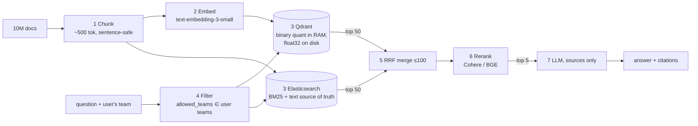

# Hybrid RAG with access control: 10M docs → 100M chunks

Team-filtered hybrid retrieval (Qdrant vectors + Elasticsearch BM25), Reciprocal Rank Fusion,
cross-encoder reranking and a citation-checked, grounded answer.



## Quick start

```bash
pip install -e ".[dev,cohere]"        # add ,bge for the open-source reranker
cp .env.example .env                  # fill in OPENAI_API_KEY / COHERE_API_KEY
docker compose up -d                  # Qdrant + Elasticsearch
make test                             # 24 unit tests, no services required
```

No API keys? Set `EMBEDDER_BACKEND=fake` and `RERANKER_BACKEND=overlap` to test steps 1, 3-6 offline
(the fake embedder is lexical only, so it won't show semantic matching).

## Test each step on its own

| Step | Command | Needs |
|---|---|---|
| 1 Chunking | `python scripts/01_chunking.py` | nothing |
| 2 Embedding | `python scripts/02_embedding.py` | OpenAI key (or fake) |
| 3 Store (both indexes) | `python scripts/03_store.py --reset` | docker + embedder |
| 4 Team filter | `python scripts/04_filter.py --team sales` / `--team hr` | step 3 done |
| 5 Hybrid search + RRF | `python scripts/05_search.py` | step 3 done |
| 6 Rerank | `python scripts/06_rerank.py` | step 3 + reranker |
| 7 Grounded answer | `python scripts/07_answer.py` | OpenAI key only |
| End-to-end | `python scripts/ask.py --team sales "What is the refund limit for invoice INV-12345?"` | all |
| Real corpus | `python scripts/ingest.py corpus.jsonl --workers 8 --bulk` | all |

Expected: sales gets `$50` with a link to the refund policy; the same question as `--team hr` finds
nothing relevant and the model refuses (the HR "$500 expenses" decoy is invisible to sales, and the sales
policy is invisible to HR).

## Layout

```
src/rag/
  chunking.py     step 1  sentence splitter + greedy packer, multiprocess streaming
  embedding.py    step 2  OpenAI embedder (batched, threaded, retries) + offline fake
  stores/         step 3  qdrant_store.py (binary quantization), es_store.py (BM25)
  indexing.py     step 3  idempotent, batched writer to both stores
  access.py       step 4  User, visible_teams, can_see
  retrieval.py    step 5  parallel search, reciprocal_rank_fusion, hydration
  rerank.py       step 6  Cohere / BGE / offline reranker
  generation.py   step 7  grounded prompt, citation validation
  pipeline.py / factory.py / config.py
scripts/          one runnable script per step
tests/            offline unit tests
```

## Design decisions worth discussing

- **Sentence-safe chunking.** Greedy packing; the only time a sentence is split is when a single sentence
  exceeds 500 tokens. Tokenizer is injectable (tests run offline). Optional sentence overlap.
- **Filter before search, in both DBs.** Pre-filtering via a Qdrant keyword payload index (created before
  data load so HNSW is filter-aware) and an ES `terms` filter. A post-hydration `can_see` check is a second
  line of defence. Chunks labelled `all` are visible to everyone.
- **Qdrant memory layout.** `on_disk=True` for float32 vectors, binary quantization with `always_ram=True`,
  search with `rescore=True, oversampling=3` (Hamming scan in RAM, rescore a few candidates from disk).
  1536 bits = 192 B/vector × 100M ≈ 19 GB RAM vs ≈ 614 GB on disk. Binary quantization works best with
  high-dimensional embeddings like these; measure recall on your data.
- **No duplicated text.** Qdrant payload holds only `doc_id` + `allowed_teams`; Elasticsearch is the text
  store and the ~100 fused IDs are hydrated with one `mget`.
- **Identifier-friendly BM25.** `text.exact` keeps `INV-12345` as a single lowercase token; the standard
  analyzer would split it.
- **RRF** uses ranks only, so BM25 scores and cosine similarities need no normalization; k=60.
- **Idempotent ingestion.** Deterministic UUIDv5 chunk IDs (shared by both stores) mean reruns overwrite
  rather than duplicate, so a crashed 100M-chunk job can restart safely.
- **Hallucination controls.** Sources-only prompt with an exact refusal sentence, temperature 0, fenced
  untrusted sources, citation indices validated against the supplied sources, and no LLM call when nothing
  is retrieved.

## Scaling notes (back-of-envelope, verify for your setup)

- **Embedding cost:** 100M chunks × ~500 tokens = ~50B tokens. At the published text-embedding-3-small price
  (check current pricing; the Batch API is cheaper) that is on the order of $1k. Throughput, not cost, is the
  bottleneck: shard the corpus across workers and respect rate limits.
- **Elasticsearch:** plan multiple primary shards (`ES_SHARDS`), tens of GB each; `--bulk` disables refresh and
  replicas during load and restores them afterwards.
- **Qdrant:** use distributed mode (multiple nodes/shards) at this size; `--bulk` defers HNSW building until the
  load finishes. The HNSW graph itself also needs RAM (or can be moved to disk, at a latency cost).
- **Reranking** is applied only to ≤100 fused candidates, since a cross-encoder cannot run over 100M chunks.

## Known limitations

- The sentence splitter is rule-based (fast, ~good). Swap in pysbd/spaCy via `split_sentences` if precision matters.
- Token counts are summed per sentence, so a chunk can differ by a few tokens from a fresh re-tokenization.
- Team membership must come from a trusted identity source in production, not from the request.
- No evaluation harness yet; the natural next step is recall@k / MRR on a labelled query set to tune
  oversampling, RRF `k` and the candidate counts.
